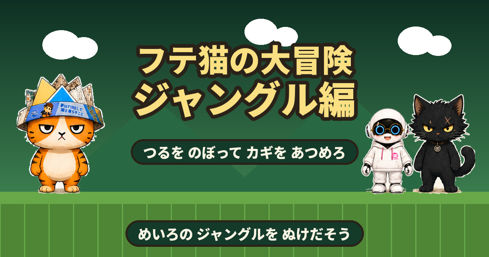

# フテ猫の大冒険 ジャングル編



ジャングルの おくで、クロネコさんが チャッピーちゃんを つれさった！
つるを のぼり、カギを さがして とびらを ひらき、めいろの おくを めざそう。

**▶ あそぶ： https://ganapati0330.github.io/futeneko-jungle/**

ブラウザだけで動く、めいろ型のアクションゲームです。
インストール不要、外部ライブラリなし、ファイル1つで完結します。

---

## このゲームの あそびかた

ステージは **たてよこに つながった めいろ**です。まっすぐ 進めば ゴールでは ありません。

1. **つる**を のぼりおりして、上の部屋・下の部屋へ 行き来する
2. あちこちの 部屋に かくれている **カギ**を ぜんぶ さがす
3. カギが そろうと **とびら**が ひらく
4. とびらの おくの **ボス部屋**で クロネコさんを たおす
5. まっていた **チャッピーちゃん**に タッチで クリア

**ミニマップ**（画面の左上）には、じぶんが 歩いたところだけが うつります。
まだ 行っていない所は まっくら。ぜんぶ 明るくする つもりで 探検しましょう。

## そうさ

### パソコン

| そうさ | キー |
| --- | --- |
| うごく | ← → ／ A D |
| ジャンプ | スペース ／ Z |
| つるを のぼる・おりる | ↑ ↓ ／ W S |
| ダッシュ | Shift ／ X |
| ポーズ | P ／ Esc |
| 音のオン・オフ | M |

↑ は、つるに つかまっていないときは ジャンプになります。

音は **最初にどこかをタップ／キーを押した瞬間**から鳴りはじめます
（ブラウザの自動再生制限のため、ページを開いただけでは鳴りません）。

### スマホ・タブレット

**画面ボタンは ありません。指の うごきだけで そうさします。**
また、さわると **自動で 全画面**になり、ページが スライドしないように 固定されます。
端末が たて向きのときは 自動で 横画面に 回転します。

| そうさ | 指の うごき |
| --- | --- |
| うごく | 画面の **左半分**を なぞる。指を おいた ところが 支点になり、なぞった方向へ 歩きます |
| ダッシュ | 左半分で **大きく（52px以上）** なぞる。スティックが ピンク色に なります |
| ジャンプ | 画面の **右半分を タップ**。おしっぱなしで 高くとべます |
| ジャンプ（片手） | 左半分で 指を **上へ はじく** |
| つるを のぼる・おりる | つるに いるときに、左半分を **上下に なぞる** |
| ポーズ／音 | 右上の ⏸ と 🔊 |

- 指の あそび幅は 8px。ほんの少し なぞれば すぐ 歩きだします。
- 指が すべっても 支点が ついてくるので、長く なぞっても ずれません。
- ななめに なぞっても きちんと 左右に 歩きます。
- 2本指も つかえます（左指で 歩きながら 右指で ジャンプ）。
- はじめの 2回だけ、画面に 操作エリアの めやすが 出ます。
- タイトルなどの メニューは、よこ長の 画面では **左右2だん組み**に なるので、
  スクロールせずに ボタンまで 見えます（万一 はみ出しても、カードの中は 指で スクロールできます）。

## ステージ

| | ステージ | 大きさ | 部屋 | カギ | ボスの たいりょく |
| --- | --- | --- | --- | --- | --- |
| 1 | つるの もり | 46×23 | 6 | 1こ | 1かい |
| 2 | きりの しっち | 61×34 | 12 | 2こ | 2かい |
| 3 | わすれられた いせき | 61×34 | 12 | 3こ | 3かい |
| 4 | ちていの しんでん | 76×34 | 15 | 3こ | 3かい |

## アイテムと しかけ

| | なまえ | はたらき |
| --- | --- | --- |
| 🌿 | **つる** | ↑↓ で のぼりおり。ジャンプで はなれられます |
| 🔑 | **カギ** | ぜんぶ あつめると とびらが ひらきます |
| 🚪 | **とびら** | ボス部屋の 入口。カギが そろうまで 通れません |
| 🐾 | **肉球ブロック** | 下から たたくと アイテムが 出ます |
| ⭐ | **スター** | でっかい むてきモード（約8秒）。ふれるだけで てきを たおせます |
| 💗 | **ハート** | ライフが 1つ ふえます（最大9） |
| 🐾 | **コイン** | 100まいで ライフが 1つ ふえます |

やられても、**その場所から いちばん近い 安全な足場**で 再スタートします。
トゲや 毒ぬまの 上、てきの すぐ横には 出てきません。

## でてくるキャラクター

- **フテ猫** — 主人公。新聞かぶとが トレードマーク。
- **チャッピーちゃん** — さらわれた なかま。各ステージの おくで まっています。
- **クロネコさん** — ライバル。めいろの中では てきとして、
  ボス部屋では **K2ユニフォーム姿のボス**として立ちはだかります。

## 技術メモ

- キャラクターは **歩行4コマ・走行4コマ・ジャンプ4コマ・待機** をそろえた
  キャラクターシートから 1カットずつ 切りぬいた 画像を つかっています。
  コマおくりは「すすんだ きょり」で かぞえるので、ゆっくり 歩けば ゆっくり、
  はしれば はやく 足が うごきます。空中では のぼり／頂点／着地の コマに 切りかわります。
  同じキャラクターの コマは すべて おなじ ばいりつに そろえてあるので、
  ポーズが かわっても 大きさが ぶれません。

- HTML / CSS / JavaScript のみ。フレームワークなし、ビルド不要。
- 画像は base64 で HTML に埋めこみ済み。**index.html 1ファイルだけで動きます**（オフライン可）。
- **めいろの自動生成**：部屋を格子状に並べ、ランダム深さ優先探索で 全域木を作り、
  そこに ループを少し足しています。となりあう部屋は、よこ道（3マス高の通路）か
  たて道（つるを通した たてあな）で つなぎます。
  カギは ボスへの道から はずれた 行き止まりの部屋に 置くので、
  かならず 寄り道が 必要になります。
  ボス部屋への 入口は（ループ道も ふくめて）**すべて とびらで ふさぎます**。
  カギが そろうと ステージ内の とびらが いっせいに ひらきます。
- **解けることの検証**：生成した めいろに対して、つる登り・落下・ジャンプ
  （ひかえめに 横3マス・上3マスまで）を考えた BFS を実行し、
  「とびらを 開ける前に カギが 全部 取れること」
  「とびらを 開ける前は ボス部屋にもゴールにも 行けないこと」
  「とびらを 開けたあと ボスとゴールに 届くこと」を 確認しています。
  ジャンプは 途中のマスが ふさがっていれば 通れない ものとして 判定するので、
  かべや とびらを すりぬける 抜け道は 生まれません。
  条件を満たす シード値が 見つかるまで 生成をくり返します。
- BGM・効果音は Web Audio API による **リアルタイム合成**。音声ファイルは1つも使っていません。
  ステージごとに 別の曲（全5曲）が流れます。
- スマホで音が出ない問題への対策として、最初のタップで AudioContext を解錠し、
  `navigator.audioSession` を `playback` に設定 ＋ 無音WAVをループ再生することで、
  **iPhone のマナーモードでも鳴る**ようにしています。
- スマホが たて向きのときは、ステージ全体を CSS で 90 度回転させて 横画面表示にしています。
  タッチ座標も回転にあわせて変換しているので、指なぞり操作が ずれません。
- スマホ向けに 画面ボタンを 置かない設計にしています。最初のタップで Fullscreen API と
  Screen Orientation API を呼び、あわせて `touchmove` / `gesturestart` の抑止、
  `overscroll-behavior:none`、`touch-action:none`、ダブルタップズームの無効化で、
  ページが スライドしたり 拡大したりしないようにしています。
- 敵とボスには **はまり脱出**の仕組みが入っています。約0.7秒 動けないままだと
  向きを変えて押し出し、それでもダメなら 近くの「体が入って 足もとに地面がある」
  マスへ 自動で 移します。かべに はまって ボスが 倒せなくなることは ありません。
- 進行状況（クリア済みステージ・ハイスコア）は localStorage に保存します。
  保存キーは `futeneko_jungle_v1` で、同じ GitHub Pages 上の 他の作品とは 別あつかいです。
- 全ステージについて、実際のゲームコードを Node.js 上で走らせるテスト
  （つる登り・カギ・とびら・ミニマップ・ボス部屋・リスポーン）と、
  サウンドのテスト（Web Audio をモックして 予約・結線・解錠処理を検証）を通しています。

## ファイル構成

```
futeneko-jungle/
├── index.html            ゲーム本体（これ1つで動きます）
├── README.md             この説明
├── LICENSE               MIT（キャラクター画像は対象外）
├── ogp.png               SNS共有用のサムネイル（1200×630）
├── apple-touch-icon.png  ホーム画面に追加したときのアイコン（180×180）
├── .nojekyll             GitHub Pages の Jekyll 処理を無効化
└── .gitignore
```

## 公開のしかた（GitHub Pages）

1. GitHub で `futeneko-jungle` という名前のリポジトリを新規作成（Public）
2. このフォルダの中身をすべてアップロードしてコミット
3. リポジトリの **Settings → Pages** を開く
4. Source を **Deploy from a branch**、Branch を **main / (root)** にして Save
5. 1〜2分ほどで `https://ganapati0330.github.io/futeneko-jungle/` に公開されます

## シリーズ

**フテ猫の大冒険**シリーズの1本です。それぞれ独立した別のゲームで、
セーブデータ（クリア済みステージ・ハイスコア）も 別々に 保存されます。

| | タイトル | 内容 |
| --- | --- | --- |
| | [フテ猫のジャンプ大冒険](https://ganapati0330.github.io/futeneko-jump/) | 横スクロールアクション（全5ステージ） |
| ★ | **フテ猫の大冒険 ジャングル編** | めいろ探検アクション（全4ステージ） |

## ライセンス

- **ソースコード**（`index.html` に含まれる HTML / CSS / JavaScript）: MIT License（[LICENSE](LICENSE) を参照）
- **キャラクターの画像・デザイン**（フテ猫、クロネコさん、チャッピーちゃん、および `ogp.png` / `apple-touch-icon.png` に含まれる図像）: © 泉正道. All rights reserved.
  MIT License の対象外です。転載・二次利用はできません。
